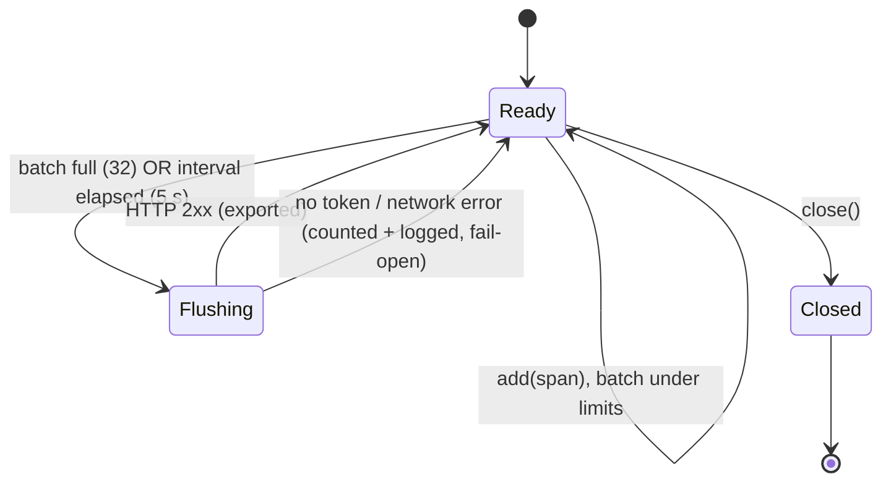

# logfire_observer

Read-only telemetry observer plugin for [Hermes Agent](https://hermes-agent.nousresearch.com).
It bridges the [Observer Hooks](https://hermes-agent.nousresearch.com/docs/developer-guide/observer-hooks)
contract to [Logfire](https://logfire.pydantic.dev) — or any OTLP/HTTP JSON
endpoint — exporting OpenTelemetry spans with GenAI semantic-convention
attributes. **Python standard library only** (`python_dependencies: []`).

```text
Hermes hook payload ──▶ observer callback (read-only) ──▶ OTel GenAI span
        ──▶ in-memory batch (32 spans / 5 s) ──▶ OTLP/HTTP JSON POST ──▶ Logfire
```

## Read-only guarantee

The plugin registers **observer hooks only**. It never uses behavior-changing
surfaces: no `pre_llm_call` context injection, no `pre_tool_call` blocking or
arg modification, no `transform_tool_result` / `transform_llm_output`. Every
callback returns `None` and failures are fail-open (logged, never raised into
the agent loop).

## What it exports

| Hook | Span name | Key attributes |
| --- | --- | --- |
| `pre_api_request` | `genai.pre_api_request` | `gen_ai.system`, `gen_ai.request.model`, gated `request` |
| `post_api_request` | `genai.post_api_request` | + `usage` → `gen_ai.usage.input_tokens` / `output_tokens`, `finish_reason`, `base_url`, `api_duration`, gated `response` |
| `api_request_error` | `genai.api_request_error` | + `error.type` / `message`, `status_code`, `retryable`, `reason` (span status = ERROR) |
| `pre_tool_call` | `genai.pre_tool_call` | `hermes.tool_name`, `status=started` |
| `post_tool_call` | `genai.post_tool_call` | + `status` (`ok`/`error`/`blocked`/`cancelled`), `duration_ms`, gated `args`/`result`, `error_type` |
| `pre_llm_call` | `genai.pre_llm_call` | `is_first_turn`, history size, gated `user_message` |
| `post_llm_call` | `genai.post_llm_call` | gated `assistant_response` |
| `on_session_start` | `genai.on_session_start` | session/turn correlation |
| `on_session_end` | `genai.on_session_end` | `completed`, `interrupted`, `reason` |

Every span carries: `hermes.telemetry_schema_version = "hermes.observer.v1"`,
correlation ids (`session_id`, `task_id`, `turn_id`, `api_request_id`,
`api_call_count`, `tool_call_id`, `parent/child_session_id`,
`parent/child_subagent_id`, `model`, `platform`, `sender_id`) when present in
the payload, and any `datamarking*` kwarg as `hermes.datamarking*` (to
correlate datamarking defenses).

**Span identity**: `traceId = sha256(session_id + ":" + turn_id)[:32]` (stable
per turn), `spanId = sha256(hook:sequence)[:16]`.

**GenAI semconv note**: `gen_ai.system` is set to the *provider* (OTel GenAI
convention: system = vendor, e.g. `openai`), falling back to the model name
when the payload has no `provider`. `gen_ai.request.model` always carries the
model.

## Privacy

- Hermes observer payloads are already sanitized; this plugin treats the
  sanitized `request` / `response` / `error` fields as canonical.
- **Content gating (default: OFF)**: message and payload contents are not
  exported — only character/entry counts (`hermes.request_chars`, …). Set
  `HERMES_LOGFIRE_INCLUDE_CONTENT=true` to export truncated contents (2000 chars).
- Text fields are truncated (512 chars for scalars, 2000 for payloads).
- `LOGFIRE_TOKEN` is only used in the `Authorization` header; it is never
  logged or exported. With an empty token the plugin **counts spans in memory
  and exports nothing** — safe to run without a Logfire account.
- Telemetry is fully opt-in end to end: `HERMES_LOGFIRE_ENABLED=false` turns
  recording off entirely.

## Export lifecycle



Batching happens in memory with a size threshold (32 spans) and a time
threshold (5 s), checked on every `add`. Network failures never propagate:
spans are dropped into `dropped_error` / `dropped_no_token` counters with a
`warning`/`debug` log line.

## Install

### Option A — directory plugin (recommended)

```bash
git clone <this-repo> ~/.hermes/plugins/logfire_observer
# or copy an existing checkout:
cp -r /path/to/hermes-logfire-observer ~/.hermes/plugins/logfire_observer
```

Then validate with Hermes itself:

```bash
hermes plugins doctor logfire_observer --ci
hermes plugins validate ~/.hermes/plugins/logfire_observer --install-deps
```

### Option B — pip entry point

```bash
pip install git+<this-repo-url>
```

The `hermes_agent.plugins` entry point in `pyproject.toml` registers the
plugin; `LOGFIRE_*` env vars configure it the same way.

### Configuration (environment variables)

| Variable | Default | Meaning |
| --- | --- | --- |
| `LOGFIRE_OTLP_ENDPOINT` | `https://logfire-api.pydantic.dev/v1/traces` | OTLP/HTTP JSON endpoint |
| `LOGFIRE_TOKEN` | *(empty)* | Bearer token; **empty = no export, in-memory counters only** |
| `LOGFIRE_SERVICE_NAME` | `hermes-agent` | OTLP `service.name` resource attribute |
| `HERMES_LOGFIRE_ENABLED` | `true` | Master switch (`false` records nothing) |
| `HERMES_LOGFIRE_INCLUDE_CONTENT` | `false` | Export truncated payload contents instead of sizes only |
| `HERMES_LOGFIRE_FLUSH_INTERVAL` | `5` | Seconds between time-based flushes |
| `HERMES_LOGFIRE_MAX_BATCH` | `32` | Spans buffered before a size-based flush |
| `HERMES_LOGFIRE_TIMEOUT` | `5` | HTTP timeout per export attempt |

For Logfire: create a project, copy its ingest token into `LOGFIRE_TOKEN`
(never commit it).

## Development

```bash
python -m venv .venv
.venv/Scripts/pip install -e ".[dev]"   # Windows; use .venv/bin on POSIX
.venv/Scripts/python -m pytest tests -q
.venv/Scripts/ruff check .
```

The test suite is hermetic: a fake plugin context, an in-memory recorder
transport, and one loopback HTTP server prove the OTLP wire format without
touching the network.

## Roadmap

- Validate in production (`hermes plugins doctor` against a live Hermes).
- Publish the repo publicly, then submit a catalog entry
  (`plugin-catalog/logfire_observer.yaml` in `NousResearch/hermes-agent`) with
  a pinned full commit SHA, a truthful `requires_hermes` floor, and
  `LOGFIRE_TOKEN` routed through Hermes' secret scope (catalog rule 11).
- Optional coverage for auxiliary calls (`pre/post_auxiliary_call`) and the
  subagent lifecycle hooks (`subagent_start`/`subagent_stop`).
